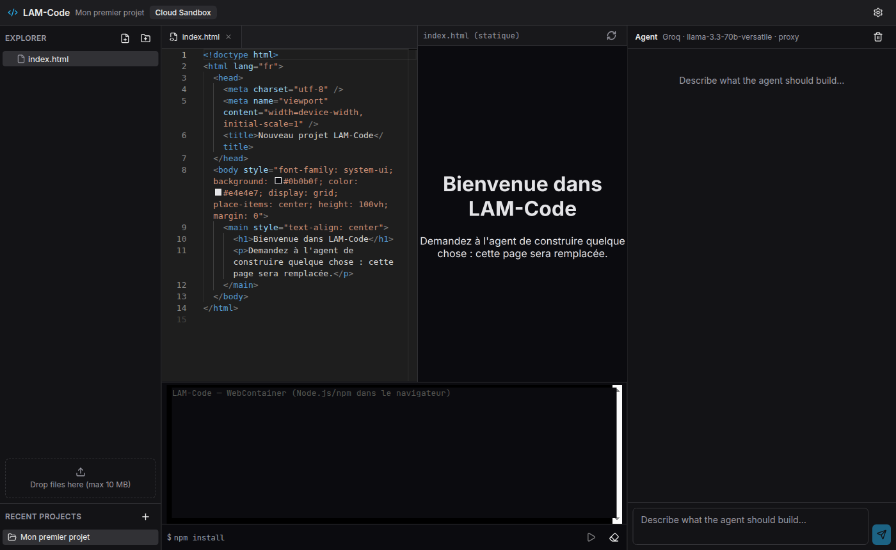
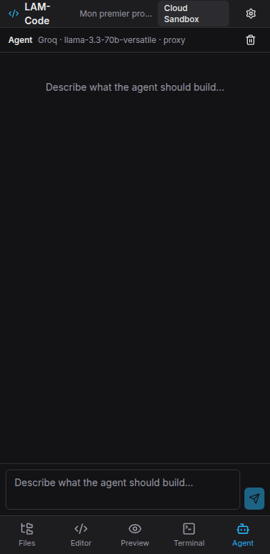

# LAM-Code

IDE agentique de développement (alternative à GitHub Copilot / Claude Code) : un agent IA qui lit, écrit et
exécute du code, se corrige seul et vous demande votre avis quand il le faut. Disponible en **Web** (Vercel),
**Windows** (Tauri v2, `.exe`) et **Android** (Capacitor 6, `.apk`).





## 1. Présentation

- Interface façon VS Code : explorateur, Monaco à onglets, terminal xterm.js, aperçu live, chat de l'agent.
  Sous 768 px : barre d'onglets (Fichiers · Éditeur · Aperçu · Terminal · Agent).
- Agent ReAct (25 étapes max, bouton Stop) avec 6 outils : `read_file`, `write_file`, `list_files`,
  `run_command`, `ask_user`, `request_file_upload`. Écritures et commandes soumises à approbation
  (Approuver / Modifier / Annuler, ou « toujours autoriser » par projet).
- Auto-correction : après une commande en échec, l'agent lit l'erreur et réessaie (3 fois max pour la même erreur,
  puis il vous pose la question).
- Fournisseurs : **Gemini (IA par défaut, via le proxy)**, Groq, OpenRouter. Mode proxy (`/api/chat`) ou direct (BYOK).
- Exécution : WebContainer (Web), PowerShell réel dans le dossier choisi (Windows), sandbox distant (Android).
- Fichiers joints : PDF (pdf.js + OCR Tesseract), images, code. Stockage local (IndexedDB / disque), synchronisation
  Supabase facultative avec snapshots.

## 2. Prérequis

- Node.js **22 LTS** (voir `docs/DECISIONS.md`, D1) et Git.
- Desktop : Rust stable et les [prérequis Windows de Tauri](https://tauri.app/start/prerequisites/) (WebView2, MSVC).
- Mobile : Android Studio (SDK 34) et JDK 17.

## 3. Lancer en local

```bash
npm install
cp .env.example .env.local   # facultatif : clés serveur et Supabase
npm run dev                  # http://localhost:5173 (sert aussi /api/chat)
```

Commandes utiles : `npm run lint`, `npm test`, `npm run build`, `npm run test:e2e`.

## 4. Configurer Supabase (facultatif)

1. Créez un projet sur [supabase.com](https://supabase.com).
2. Exécutez `supabase/migrations/0001_init.sql` (SQL Editor ou `supabase db push`) : tables `projects`, `messages`,
   `snapshots`, bucket privé `snapshots`, RLS par utilisateur.
3. Authentication → Providers : activez E-mail et GitHub (URL de redirection = URL de l'app).
4. Renseignez `VITE_SUPABASE_URL` et `VITE_SUPABASE_ANON_KEY`. Sans ces variables, l'app fonctionne en local.

## 5. Clés d'IA

- **IA par défaut** : définissez `GOOGLE_GENERATIVE_AI_API_KEY` côté serveur (Vercel ou `.env.local`). Clé gratuite :
  [aistudio.google.com/apikey](https://aistudio.google.com/apikey). Les utilisateurs sans clé utilisent alors Gemini.
- Clés personnelles : Réglages → collez la clé Groq ([console.groq.com/keys](https://console.groq.com/keys)), Gemini
  ou OpenRouter ([openrouter.ai/keys](https://openrouter.ai/keys)) → **Tester**. Elles sont chiffrées sur l'appareil
  (WebCrypto / Gestionnaire d'identifiants Windows / stockage sécurisé Android), jamais envoyées à Supabase.

## 6. Déployer sur Vercel

Le plus simple : importez le dépôt dans Vercel (preset Vite), ajoutez les variables de `.env.example`
(`GOOGLE_GENERATIVE_AI_API_KEY`, `ALLOWED_ORIGIN`, `VITE_SUPABASE_*`…). `vercel.json` fournit les en-têtes
COOP/COEP nécessaires à WebContainer. Alternative : workflow `deploy-web.yml` avec les secrets `VERCEL_TOKEN`,
`VERCEL_ORG_ID`, `VERCEL_PROJECT_ID`.

## 7. Compiler l'EXE et l'APK en local

```bash
npm run tauri build -- --bundles nsis          # Windows → src-tauri/target/release/bundle/nsis/*.exe
npm run android:sync && cd android && ./gradlew assembleDebug   # → android/app/build/outputs/apk/debug/
```

Pour Desktop/Mobile, définissez `VITE_API_BASE_URL` (URL Vercel) avant le build pour utiliser le proxy.

## 8. Compiler via GitHub Actions

1. Poussez le dépôt. Ajoutez les secrets/variables : `VITE_API_BASE_URL`, `VITE_SUPABASE_URL`,
   `VITE_SUPABASE_ANON_KEY` ; pour un APK signé : `ANDROID_KEYSTORE_BASE64`, `ANDROID_KEYSTORE_PASSWORD`,
   `ANDROID_KEY_ALIAS`, `ANDROID_KEY_PASSWORD`.
2. Générez un keystore :
   ```bash
   keytool -genkeypair -v -keystore release.jks -alias lamcode -keyalg RSA -keysize 2048 -validity 10000
   base64 -w0 release.jks   # → ANDROID_KEYSTORE_BASE64
   ```
3. `git tag v1.0.0 && git push origin v1.0.0` → l'EXE et l'APK apparaissent dans **Releases**
   (sans keystore : APK debug installable).

## 9. Installer

- **Android** : ouvrez l'APK, autorisez l'installation depuis des sources inconnues.
- **Windows** : l'installeur n'est pas signé ; SmartScreen affiche un avertissement → « Informations
  complémentaires » → « Exécuter quand même ».

## 10. Dépannage

| Problème | Solution |
|---|---|
| `crossOriginIsolated` faux / WebContainer ne démarre pas | Vérifiez les en-têtes COOP/COEP (`vercel.json`), utilisez Chrome/Edge récents, pas Safari iOS. |
| Erreur CORS sur `/api/chat` | Ajoutez l'origine dans `ALLOWED_ORIGIN` (les origines Tauri/Capacitor sont déjà autorisées). |
| 429 / quota Groq ou Gemini | Attendez, changez de modèle/fournisseur ou utilisez votre propre clé. |
| `401 missing_key` | Aucune clé serveur ni personnelle : ajoutez-en une dans Réglages. |
| Échec Gradle | JDK 17, `ANDROID_HOME` défini, `npx cap sync android` relancé. |
| Build Vite à court de mémoire | Le script utilise déjà `--max-old-space-size=4096`. |

## 11. Limites connues et feuille de route

- Web : uniquement Node.js/JS/TS (pas de Python, Rust, Java natifs) ; l'agent génère le code et explique comment
  l'exécuter en local.
- Android : pas de shell local ; exécution via un sandbox distant (`POST /exec`) ou erreur explicite.
- Windows : exécutable non signé ; macOS/Linux non packagés (le code Rust compile sous Linux).
- Feuille de route : diff visuel avant écriture, sandbox distant clé en main, signature de code Windows.

Décisions d'architecture : [`docs/DECISIONS.md`](docs/DECISIONS.md).
